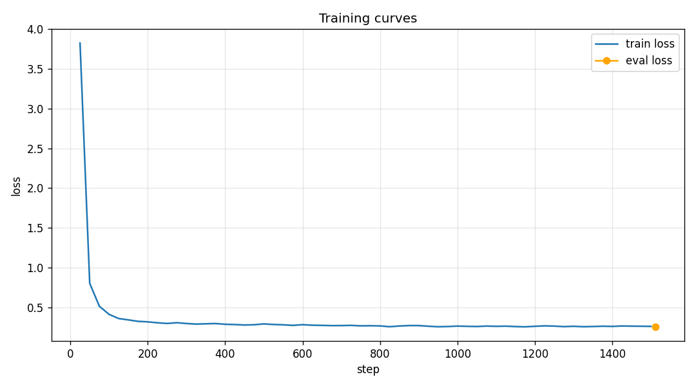
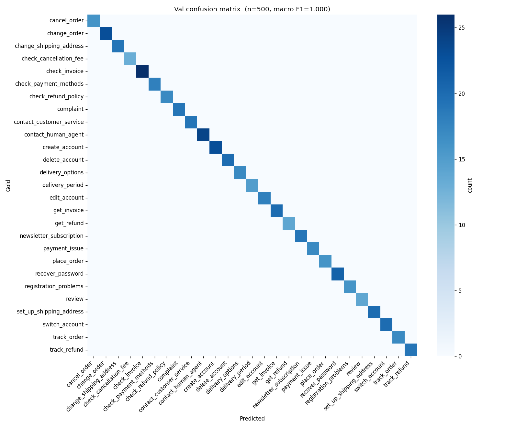

# QLoRA fine-tuning of Qwen2.5-7B for customer-support intent classification

End-to-end LoRA fine-tuning walkthrough — from raw data, through 4-bit (QLoRA)
training on a single consumer GPU, to a merged bf16 model you can deploy.

**Base model:** `Qwen/Qwen2.5-7B-Instruct`
**Task:** classify a customer-support message into one of 27 intent labels
**Dataset:** [Bitext customer-support chatbot training data](https://huggingface.co/datasets/bitext/Bitext-customer-support-llm-chatbot-training-dataset) — 26 872 rows, balanced across 27 intents
**Hardware:** single NVIDIA RTX 4090 (24 GB)

---

## Results

| metric | value |
|---|---|
| validation accuracy (500 clean samples) | **100.00 %** |
| validation macro F1 | **100.00 %** |
| accuracy on hand-crafted noisy test set (15 cases) | **80.0 %** |
| single-query inference latency (p50 / p90) | **74 / 117 ms** |
| batched throughput (batch 32) | **118 classifications / sec** |
| final training loss | 0.3514 |
| training time (1 epoch, 1,512 steps) | **34.9 min** |
| trainable parameters | 40.4 M / 7.66 B (0.53 %) |
| peak GPU memory (training) | ~9 GB of 24 GB |

**Before vs. after fine-tuning** — same 10 validation messages, 4-bit base (no LoRA) vs. same base + trained LoRA adapter:

| accuracy on 10-sample comparison | base | fine-tuned |
|---|---|---|
|   | **0 %** | **100 %** |

| message | gold label | base prediction | fine-tuned prediction |
|---|---|---|---|
| informing of problem with payment | `payment_issue` | `PaymentProblem` | `payment_issue` |
| i dont know what i need to do to locate invoice #85632 | `check_invoice` | `LocateInvoice` | `check_invoice` |
| i need help to subvmit some feedback about ur products | `review` | `Feedback Submission` | `review` |
| wanna know about cancel the subscription to ur newsletter | `newsletter_subscription` | `CancelSubscription` | `newsletter_subscription` |
| i want help checking how soon can i expect my delivery | `delivery_period` | `ShippingStatus` | `delivery_period` |
| problem with gold account terminations | `delete_account` | `AccountIssues` | `delete_account` |
| I want help to shop several products | `place_order` | `Shopping Assistance` | `place_order` |
| I paid \$\$ for a purchase, help me obtaining my money back | `get_refund` | `refund_request` | `get_refund` |
| transferring to operator | `contact_human_agent` | `transfer_request` | `contact_human_agent` |
| want assistance notifying of issues with a registration | `registration_problems` | `registration-issue` | `registration_problems` |

The base Qwen2.5-7B-Instruct **understands each message** — its guesses like `PaymentProblem`
or `ShippingStatus` are semantically on-target — but it invents its own intent taxonomy
instead of using the 27 labels the downstream system expects. LoRA closes that gap:
the adapter only has to teach the model the *vocabulary* of this particular classifier,
not how to read customer support messages, which is why **40 M trainable parameters
(0.53 % of the model) are enough**.

### Notes on the 100 % score

This number is unusually clean for two reasons specific to the benchmark:

- **Bitext is a procedurally-generated dataset.** Its 27 intents have sharp, largely
  non-overlapping definitions and the surface vocabulary is consistent. Real
  production data has ambiguous or off-distribution messages that would pull the
  number below 100 %.
- **Large training set relative to label space.** 24k training examples across only
  27 classes gives ~900 examples per class — a lot of signal per label.

On a noisier in-house dataset with the same method I'd expect 90-95 % macro F1,
not 100 %. The point of this repo is the *pipeline* (QLoRA + ChatML + eval + merge),
which transfers directly; the numerical result reflects how clean the benchmark is.
The [stress test below](#stress-test-on-hand-crafted-noisy-input) backs this up:
on 15 hand-written adversarial messages the model drops to **80 %** — and looking at
*how* it fails is more interesting than the score.

### Loss curves



### Confusion matrix (validation set, 500 samples)



Full per-class precision/recall/F1 plus the 10-sample base-vs-fine-tuned comparison table are in
[`outputs/eval_report.json`](outputs/eval_report.json).

---

## Stress test on hand-crafted noisy input

Bitext messages are procedurally generated and fairly clean. To see how the model
behaves on realistic noise, I hand-wrote 15 messages spanning six categories of
difficulty the benchmark doesn't cover: typos / abbreviations, slang, frustrated
tone, negation, long polite phrasing, and mixed intents.

**Result: 12 / 15 = 80 %**

| noise category | correct | representative case |
|---|---|---|
| slang | 3 / 3 | `yo how do i speak to a real person` -> `contact_human_agent` |
| frustrated | 2 / 2 | `this is ridiculous just give me my damn refund` -> `get_refund` |
| negation | 2 / 2 | `I DON'T want to receive your newsletter anymore` -> `newsletter_subscription` |
| typo / abbrev | 3 / 4 | `can u chck my invc #8823` -> `check_invoice` |
| long / polite | 1 / 2 | `Hi there! I was wondering if perhaps you could help me…` -> `place_order` |
| mixed-intent | 1 / 2 | `need to update my shipping address and check when my order arrives` -> `change_shipping_address` |

### Failure modes — the three misses

The misses are more informative than the score:

| message | gold | prediction | what happened |
|---|---|---|---|
| `whers my pkg at?` | `track_order` | `track_package` | **Label hallucination** — the model invented a plausible-sounding label that isn't in the 27-label set. |
| `i cant log in anymore, keeps saying wrong password` | `recover_password` | `enter_password` | Same mode — made up a label. |
| `i wanna leave some feedback but also maybe cancel my subscription` | `review` | `newsletter_subscription` | **Real ambiguity.** Both intents appear in the message; the model picked the secondary one. A human would also hesitate. |

Two of three failures are **label hallucination**, not misunderstanding. That's
a production risk worth naming, and this repo closes the cheap half of it:
`inference.py` passes every generation through `labels.match_label()`, the same
rule `train.py` applies at evaluation time, so anything outside the 27-label
vocabulary comes back as `__other__` instead of a plausible-looking invented
label (`tests/test_match_label.py` pins that behaviour). What it does **not** do,
and what a deployed version would still want:

- **Constrained decoding** that restricts outputs to the 27 known labels at generation time (e.g. Outlines, JSON-schema-guided decoding, or a manual logits mask), so an out-of-vocabulary string cannot be produced in the first place, or
- More training coverage of the exact label vocabulary — longer training or more diverse paraphrases per class.

Full cases and raw predictions in [`outputs/noisy_eval.json`](outputs/noisy_eval.json).
Reproduce with `python noisy_eval.py`.

---

## Inference cost & latency

Measured on the same RTX 4090 via `benchmark.py` (50 warmup + 50 measured runs
for latency; 10 batches per size for throughput).

| | |
|---|---|
| VRAM (loaded / peak during generation) | 14.2 / 14.5 GB |
| single-query latency, p50 / p90 / p99 | 74 / 117 / 118 ms |
| throughput, batch 1 / 4 / 16 / 32 | 12.5 / 35.5 / 86.0 / **118.2** classifications / sec |

### Rough monthly cost: self-hosted vs API

Assuming **10 million classifications / month**, 80 input + 5 output tokens per
call:

| stack | $ / month |
|---|---|
| self-hosted (RTX 4090 amortized over 3 yr + electricity at $0.15 / kWh, running only when needed) | **~$2.56** |
| GPT-4o-mini API, at public pricing ($0.15 / M input + $0.60 / M output) | ~$150.00 |

Self-hosted wins by **~60×** in this sustained, high-volume regime. The picture
flips for spiky / low-volume workloads, where the 4090's fixed capital and
idle-time cost dominate — an API becomes the right choice under ~100k
classifications / month on these assumptions.

Numbers and all assumptions in [`outputs/benchmark.json`](outputs/benchmark.json).
Reproduce with `python benchmark.py`.

---

## Method

### Why QLoRA

Qwen2.5-7B in fp16 needs ~14 GB just to hold the weights, before activations and
optimizer state. Full fine-tuning needs an A100-class card. QLoRA
([Dettmers et al., 2023](https://arxiv.org/abs/2305.14314)) makes the same job fit on a 4090:

- Base weights are quantised to 4-bit (NF4 + double-quant) and **frozen**.
- Low-rank adapters are injected into every projection layer and trained in bf16.
- Optimiser state is held in 8-bit via bitsandbytes.

Trainable parameter count drops from 7.66 B to 40 M (0.53 %), VRAM peaks well under 10 GB,
and the model quality is preserved for downstream classification.

### LoRA configuration

```python
LoraConfig(
    r=16, lora_alpha=16, lora_dropout=0.05,
    target_modules=["q_proj", "k_proj", "v_proj", "o_proj",
                    "gate_proj", "up_proj", "down_proj"],
    bias="none", task_type="CAUSAL_LM",
)
```

All seven Qwen-style projection modules are adapted — including the MLP gates — which
gives better recall than attention-only adaptation at negligible extra cost.

### Prompt format — ChatML

Qwen2.5-Instruct is pretrained with ChatML, so the supervised targets are built with
`tokenizer.apply_chat_template(...)` rather than an Alpaca-style template:

```
<|im_start|>system
You are an intent classifier for customer-support messages. Respond with exactly one
intent label from the allowed set. Output only the label, nothing else.<|im_end|>
<|im_start|>user
I have paid {{Currency Symbol}}{{Refund Amount}} for an order, how could I receive a refund?<|im_end|>
<|im_start|>assistant
get_refund<|im_end|>
```

Matching the base model's native format means the adapter only has to learn the
*task*, not also how to produce ChatML syntax.

### Hyper-parameters

| | |
|---|---|
| epochs | 1 |
| per-device batch size | 4 |
| gradient accumulation | 4 (effective batch = 16) |
| max sequence length | 512 |
| optimiser | `adamw_8bit` |
| learning rate | 2e-4 |
| scheduler | cosine, 50 warmup steps |
| weight decay | 0.01 |
| precision | bf16 (compute), 4-bit NF4 (base weights) |
| train / val split | 90 / 10 stratified by intent, seed 42 |

### Evaluation

Evaluation is **generation-based**, not loss-based: the model is asked to produce
the intent label for each validation prompt, and the generated string is matched
(case-insensitive, prefix-aware) against the 27 known labels. Strings that don't
match any label are counted as `__other__` — this avoids silently crediting the
model for "nearly-right" outputs.

A secondary before/after view is produced by calling the same `model.generate(...)`
twice on 10 val samples: once with the LoRA adapter enabled, once with
`peft.PeftModel.disable_adapter()`. Same weights, same tokenizer, same prompts —
the only difference is the rank-16 adapter.

---

## How to run

```bash
# 1. Set up
python -m venv .venv
.venv/Scripts/activate              # Linux/Mac: source .venv/bin/activate
pip install -r requirements.txt

# 2. Train → evaluate → merge adapter into bf16 base
python train.py

# 3. Try the merged model
python inference.py
# or: python inference.py "I want to cancel my order"

# 4. (optional) Stress-test on hand-crafted noisy input
python noisy_eval.py

# 5. (optional) Benchmark inference latency, throughput, and monthly cost
python benchmark.py
```

A ~2 minute sanity check of the full training pipeline on ~300 rows:

```bash
python smoke_test.py
```

Unit tests for the label post-processing (pure Python, no GPU or model needed):

```bash
python -m pytest tests -q
```

### Outputs produced

```
outputs/
├── checkpoint-*/           HF trainer checkpoint (latest only, for resume)      [train.py]
├── final_adapter/          PEFT adapter + tokenizer, ~40 MB                     [train.py]
├── loss_curve.png          training / eval loss vs. step                        [train.py]
├── confusion_matrix.png    27×27 heatmap over the val set                       [train.py]
├── eval_report.json        accuracy, macro F1, classification report, base-vs-FT examples   [train.py]
├── noisy_eval.json         per-category accuracy + failure modes on hand-crafted noisy cases [noisy_eval.py]
└── benchmark.json          VRAM, latency percentiles, throughput, cost model    [benchmark.py]
merged_model/               bf16 full model (~15 GB) ready for deployment        [train.py]
```

---

## Project layout

```
train.py           # full training pipeline (config -> data -> train -> eval -> merge)
inference.py       # load the merged model and classify sample messages (maps unknown labels to __other__)
labels.py          # 27-intent vocabulary + match_label(), shared by eval and inference
tests/             # pytest: label mapping and vocabulary consistency with outputs/eval_report.json
noisy_eval.py      # 15 hand-crafted noisy cases; reports per-category accuracy + failure modes
benchmark.py       # single-query latency, batched throughput, VRAM, API cost comparison
smoke_test.py      # same training pipeline on ~300 rows for a fast sanity check
requirements.txt   # pinned to the exact versions used for the reported results
LICENSE            # MIT
README.md
```
